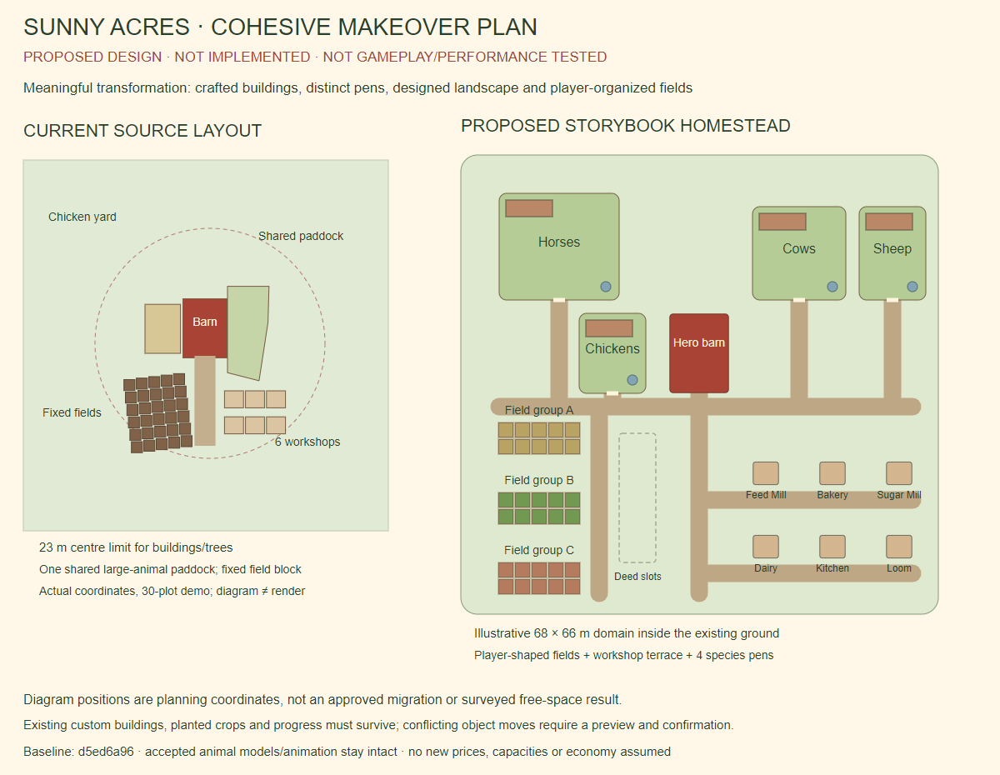

# Sunny Acres complete makeover and layout freedom — feasibility proposal

Planning complete; implementation is not authorized. The owner revised the scope after the terrain-only pilot proposal: **“a complete flip of appearance in a good way”**, separate horse/cow/sheep/chicken pens, more usable building-placement area, and crop plots players can move to organize separated fields. That supersedes the narrow pilot as the recommended next task. The completed visual audit remains immutable at `8c9123713e455f900dec33c59ed00b37fb8d002d`; its proposed pilot was never implemented.

This document recommends design and mechanics for approval. It does not claim an approved art direction, implemented feature, tested migration or demonstrated performance improvement. The owner's requirements above are the requested outcome; dimensions, controls, migration policies and budgets below are recommendations. No new prices, plot entitlements, animal capacity, economic rewards or farmhouse gameplay are assumed.

## Exact baseline and deliverables

- Authoritative runtime: published main `d5ed6a96c50914320f30a7b74b799b7f66a9b6e0`, tree `05ac4ee6c3ff982ba2e8925d68fd5077667d058f`. Remote main was fetched/verified before planning; final remote receipt accompanies this checkpoint.
- Documentation base: visual audit `8c9123713e455f900dec33c59ed00b37fb8d002d`. Branch `codex/phase7n-makeover-layout-plan`; no PR. The exact documentation head is the commit containing this file, recorded in the delivery packet and final handoff.
- [Proposed layout diagram](evidence/phase7n-makeover-layout-plan/proposed-layout.png), [editable vector diagram](evidence/phase7n-makeover-layout-plan/proposed-layout.svg), [baseline/proposal review page](evidence/phase7n-makeover-layout-plan/preview.html), [exact-source excerpts and derived bounds](evidence/phase7n-makeover-layout-plan/source-contracts.json), [scope/integrity receipt](evidence/phase7n-makeover-layout-plan/scope-check.json).
- Actual unchanged baseline: [Classic courtyard](evidence/phase7n-visual-style-audit/captures/desktop-classic-noon-courtyard.png), [golden courtyard](evidence/phase7n-visual-style-audit/captures/mobile-844-classic-golden-courtyard.png), [Walk at 844×390](evidence/phase7n-visual-style-audit/captures/mobile-844-walk-noon-path.png), plus all 15 previously captured views. No passing capture or qualification test was repeated.



## Read-only findings from the actual implementation

| Contract | Current implementation | Consequence for the requested work |
|---|---|---|
| Ground vs usable space | `index.html:1181` builds a 220×220 m ground mesh. It is flat only inside radius16; outer ground has rolling heights. `groundAt()` uses a y=0 plane; movable objects currently sit at y=0. | Ground-mesh enlargement is unnecessary for a roughly 68×66 m illustrative farm. A bigger *usable/playable* area still requires terrain grading or height-aware foundations, placement bounds, camera bounds and navigation changes. It is not already clear, level, accessible land just because grass renders there. |
| Building placement | `editValid()` has a 23 m centre radius from HOME(1,3), excludes the main lane, blocks/pens/plots/decor/trees. Buildings use half extents1.9×1.7. All six workshop lots, including unowned ones, are editable and reserve blocks; positions persist in `layout.b`. | Extend a named placement region, not just the radius literal. Test the complete footprint, entrances, reserved lots and access. Retain each building's stable key, ownership, job queue and saved position. Unowned lots are part of compatibility, not empty space to silently reclaim. |
| Other bounds | Decoration centres have radius24; Walk clamps to radius40. Classic/Edit camera target x is [-24,24], z [-18,28], and distance is capped at70. Edit grid is56 m with1 m cells, centred at(1,7). | These disagree already. One region model must drive future placement/map/framing/access, with separate physical and decorative limits. Proposed corner(-34,38) is about49.5 m from HOME, beyond current Walk radius. A full-map camera must demonstrably fit the wider domain; the old clamps/zoom cap cannot be assumed sufficient. |
| Pens and navigation | Fixed convex `PENS`: cow/horse/sheep share the east paddock; chicken has a west yard. Fence segments, water, bed, rain shelter, pen signs, obstacle boxes and route search are authored separately. Animal `ROAM=19`; route corners are limited around HOME. | Four fences alone are insufficient. One enclosure definition must generate species membership, fencing, care gate, water/bed/shelter points, signs and collision/navigation data. New pens outside the old roaming radius otherwise become unreachable or use fallback routes. |
| Accepted animals | `syncHerd()` identities are `pen:kind:index` and `pet:index`; production/care state is `pens[kind].owned/list/meta`. World positions/routes are transient, rebuilt from pen data. Social targets, bait, shelter/night points and fence avoidance depend on the current pen. | Retain model/material/rig/contact/gait modules and species slot identities. Update scene navigation integration only after approval. Avoid cross-pen social paths and stale cached goals; test horse turning/stopping/runway space with the unchanged rig. Do not respawn or translate a moving animal without resetting/translating world-space contact anchors through the established safe path. |
| Plot identity | `S.plots[i]` holds crop/end/dur/water/fert/hot/soil/soilAt/last. The renderer creates its transform from fixed `FIELD_SLOTS[i]`. Plot hit IDs, harvest/seed swipes, focus/effects and friend help all use `i`. Sprinklers cover `i < sprinklers*6`. | Move coordinates, never reorder, splice/reinsert, replace or duplicate plot objects. Purchase index is the durable identity. This preserves crop timing, fertilizer, soil history, automation and incoming friend watering. |
| Field navigation | A fixed whole-field box is in BLOCKS. `FIELD_BLOCKS` is recognized by hard-coded old coordinates and excluded from Walk collision/drop bounce, while animals avoid the field area. Grass clearings, plot decals and underfoot surfaces use plot positions. | Split fields require explicit per-plot/group occupancy and type tags. Replace the monolithic old box; preserve Walk access over plots and animal avoidance of planted beds. Move decals/clearings/hit proxies/effects as one operation. Leaving the old box would invisibly block new buildings in vacated space. |
| Current land economy | Six starting plots, base cap30; three existing deeds each add6, max48. Deeds currently append capacity/columns west, not a building-region ownership model. | Wider arrangement space and additional plot entitlement are different features. Recommend making the wider placement domain available without new charges, preserving existing deed prices/levels and the exact 30+6+6+6 cap. Owner must choose if region access should instead be gated; no pricing or mapping is invented here. |
| Saves/cloud | `SAVE_VERSION=1`, same local key; ordered migration ladder is ready but empty. `save()` refuses normal writes from an older cached client reading a newer version. Cloud/showcase transfer JSON text, with existing revision conflict checks; rules permit opaque save text up to900,000 characters. | A versioned layout migration can use the existing transport without a rules/backend change. Old-client write protection must remain; its ordinary-save guard is not proof that old restore/import paths are safe. Validate mixed-version and rollback behavior explicitly before rollout. No fresh live rules review is needed. |
| Backup/offline | Backup envelope v1 contains `farm:S`; SA1/SA2 codes and JSON restore call `upgrade/adopt`. Restore currently caps at48. Worker v43 caches code/engine/assets, with network-first code and cache-first heavy assets refreshed in background. | Farm schema version and backup-envelope version are separate. Preserve historical imports/codes; include new layout through the existing farm payload. Future asset/cache versioning must avoid mixed scene/code versions and stale heavy art. Do not delete unrelated caches or allow old UI to rewrite a migrated farm. |
| Verified fields | Public `verifiedEconomy` is off. Its separate server IDs p0…p5 and trading state differ from normal `S.plots`. | This plan concerns ordinary local/cloud-saved farm plots. No verified-field/server-economic feature switch, Firestore collection, function or security change. |

Code-equivalent static arithmetic finds the30 default plot centres spanning x[-15.11,-3.69], z[10.16,23.77];48 span x[-22.56,-3.69], z[10.16,24.67]. Their furthest centres are25.40/30.92 m from HOME, already beyond the building centre limit. These values describe current coordinates, not a buildable-area survey or new test pass. Exact source snippets/hashes are in source-contracts.json.

## Cohesive visual direction: a spacious storybook countryside homestead

The visual flip should come from architecture, layout and landscape together. Keep Sunny Acres recognition through a rich red timber barn, cream country architecture, warm soil and wood fencing, but replace the repeated small-box/bright-roof composition with a deliberately arranged farm. Accepted animals remain the same quality reference.

- **Barn and workshops:** a crafted gambrel barn with recessed doors/windows, thicker eaves, wood direction, restrained stone footing and readable roof masses. Preserve the barn's door/root/proxy contracts and usable entrance. Give the six existing workshop identities distinct silhouettes: timber feed mill, warm bakery storefront, pale dairy, compact sugar mill, garden kitchen and woven/textile accents at the loom. Use slate/clay/wood roofing as one material family rather than unrelated saturated roofs. Preserve existing paint/customization choices by semantic Walls/Trim/Roof mapping; do not overwrite stored style. A cream farmhouse may be a later decorative backdrop choice, not a new purchased job/revenue building assumed by this plan.
- **Landscape:** gravel/earth courtyard with deliberate wear, short grass around work areas, clustered flowers at borders, mature shade trees and hedgerows framing the countryside. Open usable terraces should look open and remain usable. Replace excessive near-ground texture noise with broader material values; avoid adding more alpha grass everywhere. Distant scenery can frame the farm without becoming an invisible building blocker. No pond, water mechanic, seasonal pricing or extra production system is proposed.
- **Four enclosures:** generous horse rail pasture/runway, cow pasture beside the barn approach, sheep meadow and chicken coop/run. Each has its own water/shelter/bed and species sign/care access. Different fence/vegetation treatments should make them recognizable without changing animal anatomy or capacity. Keep dogs/cats outside animal containment while allowing their existing follow/chase/nap behavior.
- **Light:** gentler daylight separation, warm evening sun and cool readable shadows; night/weather remain distinct. Start with the existing sun/hemi/fill/point-light inventory and composer. Tune the environment, not animal coat materials or rigs. New light direction/color can change how an accepted coat reads, so compare actual animals under all presets before owner acceptance. No extra shadow-casting lights or heavyweight postprocess.
- **Interface:** quieter cream/wood/forest accents, clearer grouped actions and a dedicated Layout mode, while Orders/Barn/Shop and primary Walk action remain immediate. Preserve all existing features, readable counters, accessible labels and thumb-safe controls. Group secondary cosmetics/settings only if the owner accepts the extra navigation step. Keep Walk joystick/aim/action placement stable initially; show editing tools only in Layout mode.

Working palette references: barn #A84335, cream #F0DBAF, slate #424E57, meadow #64894C, sunlit grass #97AE62, soil #765540, worn lane #AF9570. These reuse documented historical art direction, not approved rendered colors. The phase7mx experimental barn is not accepted art or a production-ready asset; it is not automatically selected for this makeover.

## Layout and placement design

The diagram illustrates a68×66 m usable domain, x[-34,34], z[-28,38], entirely within the existing ground mesh. It is a planning envelope, not an approved minimum, precise free-space result or claimed capacity. Grade a contiguous buildable plateau and feather its boundary into existing hills, or deliberately use height-aware foundations; recommend the plateau first to retain existing y=0 ground contact and simpler phone placement.

One barn/courtyard anchor connects four distinct enclosures, an extended workshop terrace and player-shaped crop areas. The diagram's three10-plot groups demonstrate a30-plot farm without awarding anything. Dotted deed space represents placement for already-earned/purchased capacity, not18 free extra plots. Existing workshop lots remain stable logical objects even if a new-farm default layout changes their coordinates. Player farms can arrange buildings/plots throughout the valid domain; the pictured districts are suggested organization, not mandatory zoning.

Recommended first mechanics:

1. Fixed species enclosure templates with sufficient horse running/turning space, care paths and player-access gates; animals remain contained by their own polygons. Player-only gate traversal can preserve animal containment. Enclosure relocation/resize/freehand fence building is deferred; the owner requested separated pens, not a fence-construction economy. Gate/care behavior is proposed and needs inclusion in the implementation scope.
2. Individual building/lot/tree/decoration/plot movement in explicit Layout mode. Moving an owned planted plot is permitted and free as a recommended preservation default; it does not harvest/replant/water it. Rotation is initially quarter-turns for buildings/plots, preserving the exact legacy angle when untouched. Free arbitrary rotation is deferred. Owned object counts and all existing prices stay unchanged.
3. Smart row/column alignment for plots at a2.5 m suggested pitch, with0.5 m fine nudges. The smallest first implementation is single-plot movement; group selection/field templates follow once atomic single-object operations are safe. Group move preserves every purchase index and crop payload. Templates arrange selected *owned* plots; they do not grant new plots or reorder IDs.
4. One footprint/region validator shared by ghost, commit and save-layout load. Check finite coordinates and known keys; rotated footprint, occupied buildings/lots, crop beds, trees/decor, fences/pens, terrain limits and protected entrances/paths. Centre/corner sampling alone is insufficient for a building intersecting a convex pen edge. Use full polygon/rectangle intersection with clearance, accounting for rotation and height. Allow adjacency where intended; reject actual overlap with a clear reason.
5. Reserve at least2 m clear connecting paths as a proposed minimum, plus a wider horse circulation area inside its pen. Validate player reach from barn/home to every entrance/care gate and usable plot/production location. Keep a large cosmetic path overlay from silently reducing placement freedom. A player can split fields without trapping a building, pen or avatar. Exact clearances require a future geometry/navigation proof.

**Phone interaction:** tap an object while Layout mode is active, then drag an offset ghost or tap a destination. Outline the full footprint and provide text/icon validity reasons, not red/green alone. Two fingers pan/zoom without committing or losing the pending ghost. A bottom row occupying at most about30% of the small landscape viewport shows object identity, Move/Rotate/Nudge, **Place** and **Cancel**; minimum44 px targets, larger primary buttons where space permits. Release only updates the ghost. Explicit Place revalidates and commits once; Cancel, pointercancel, app hide, leaving mode, visit/account switch or lost capture leaves saved state unchanged. During Layout mode, gestures never harvest, plant, buy, feed or spend resources. Show “Plot12 · Wheat · watered · ready in…” so a player knows the planted crop travels with it.

An optional batch preview lists changed object coordinates and allows Apply/Cancel. Undo-last-layout-edit can be a later layout-only operation; it must not restore old coins/crop/quest state over progress made meanwhile. No “reset everything” or silent farm shuffle default. Keep a valid fallback position reserved for any newly purchased plot/lot; if the domain has no valid position, reject the proposed placement/purchase cleanly before charging rather than losing ownership or hiding a paid object. This flow change needs explicit mechanic approval, with existing prices intact.

## Migration and save-compatibility plan

Recommend farm schema v2, retaining `sunny-acres-3d-v1` as the storage key and the existing raw-save cloud envelope/revision mechanism. Add one ordered pure `MIGRATIONS[1]` step and fixtures; no old migration rewrite. Proposed layout structure:

```json
{
  "v": 2,
  "layout": {
    "schema": 1,
    "mode": "legacy",
    "b": {"feedmill": [5.8, 14.2]},
    "t": {"tree": [-9, 4]},
    "p": {"0": {"x": -10.149640259111148, "z": 10.758989205182667, "yaw": 0.12}},
    "enclosures": {"template": "legacy-v1"}
  }
}
```

This illustrates partial legacy-preserving layout metadata, not a complete farm/migration fixture. Actual legacy coordinates for every index must come from exact `FIELD_SLOTS[i]`; the sample is current plot0. A confirmed safe transition would select mode `homestead` and a matching enclosure template. Building/tree arrays can remain compatible until rotation is separately introduced with explicit handling. Enclosure template describes renderer layout, never replaces `S.pens` economic/care state.

Migration must copy existing building/lot and tree coordinates exactly; materialize every owned plot's actual old coordinate and yaw without changing its array position. Preserve unknown compatible data. Keep all other existing state semantically identical: coins/gems/XP/level, inventory/gold/capacity, land/deeds/sprinklers/perks, owned buildings/jobs/end times, animal slots/names/happiness/cooldowns/production timers, pets, decorations/style/wardrobe, calendar/quests/achievements/orders/events/visitor/rush. Do not call gameplay actions or recompute planted crop end/dur from today's season/location. No new ownership, reset growth, fertilizer loss, repeated water boost or fresh XP/reward occurs from migration/movement.

**Collision risk on old customized farms:** new pen/shelter/path regions can intersect current custom lots, trees or decor; current `applyLayout()` does not itself revalidate positions. Coordinate-only plot migration does not solve this. Build a deterministic compatibility planner against all saved footprints, including unowned reserved lots. Prefer a collision-free enclosure template in available space while preserving every saved object coordinate. If no safe solution exists, retain the legacy scene/save layout and offer a marked one-time layout preview with the exact required relocations. Cancel defers adoption; Apply must explicitly confirm those coordinate changes while preserving every crop/progress payload. Never automatically push custom buildings or planted fields aside to make the new art fit. The choice of this opt-in transition versus a mandatory migration is an owner gate; the target remains four distinct pens after a safe approved transition.

**Validation/recovery:** deterministic, idempotent migration on copies; no Date.now/random-dependent positions. Before write, keep the original raw save under a bounded migration-backup key and verify its write succeeds. Invalid layout data is quarantined for review without resetting the farm or discarding fields; render a safe derived compatibility view without serializing substitute coordinates until explicitly confirmed. If snapshot/commit fails due to quota, remain on the original save and show a recoverable message. Reject unsupported/future versions safely. Do not turn repeated reloads into duplicated backups, plot IDs, shelters, purchases or overwritten progress. A layout-only Cancel must leave the raw save unchanged.

**Persistence surfaces:** local reload/offline reboot, SA1/SA2/file backup restore, historical2D/3D import, account-local switching, whole-farm cloud choice/revision conflict and friend showcase/visits all need distinct migration/layout coverage. Incoming friend watering keeps the original index; server-verified fields are excluded. Sprinklers continue to follow the same eligible purchase indices wherever a plot moves; visual sprinkler heads follow the plot. Do not silently change coverage to distance/radius. This is the safe default that preserves purchased automation, not a new irrigator system.

**Mixed versions/rollback:** existing v1 clients refuse ordinary `save()` on v2, but can still display their old fixed layout and have separate restore/import/account paths. Do not promise seamless editable downgrade. Confirm a new v2 farm cannot be downwritten through any path; preserve raw cloud conflict choices. Rollback to v1 code requires a separate approved operational plan that retains v2 data and migration backup; it is not “restore the old farm” because that would lose subsequent progress. Future cache/version bumps must include every new required art/module, atomic shell installation and tested fallback. Existing cache tests prove old flows only, not the future makeover. No rules/backend deployment is necessary for proposed raw JSON layout metadata; measure payload size below the existing limit.

## Prioritized sequence and acceptance gates

| Stage | Bounded deliverable | Acceptance before advancing |
|---|---|---|
| 0 — full scene proof | Owner-approved isolated renderer preview of the coherent new barn/workshop/landscape/light/UI language, four visible species enclosures, a larger terrace and three separated field groups using the same owned demo state. No production save, mechanics rollout or animal remodel. | Side-by-side actual baseline/candidate Classic and Walk; visible transformation across architecture/layout/materials, clear mobile silhouettes/controls. Candidate must be an actual renderer/composer study, labeled preview. Concept diagrams do not close this gate. Owner chooses direction. |
| 1 — identity and migration foundation | Central region/layout contract and pure v1→v2 migration with stable plot indices, legacy coordinate fallback and recovery snapshot. No automatic restyling/rearrangement on player saves. | Exact before/after state invariants excluding approved version/layout additions; original raw retained, idempotent repeated load, malformed/future/quota guards, historical imports/backups and mixed-version conflict paths. Draft review; no release. |
| 2 — usable world and four pens | Implement plateau/domain/camera/access, unified enclosure/fence/shelter/water/sign data and species-aware obstacle/navigation integration. Apply only safe compatibility layouts. | All20 penned animals+dog/cat, correct ownership/care/reward identities, running/turning/stopping with unchanged rig tolerances; independent containment and water/shelter/night/social/bait/pet paths; reachable gates/buildings. Exact saved custom coordinates and economic payload preserved. |
| 3 — move single plots/buildings | Transactional Layout mode, validator, Place/Cancel, typed field occupancy/clearings/decals/hit effects and persistent coordinates. | Move planted/ripe/empty/watered/fertilized/hot/exhausted/sprinkled plots with exact state identity; no gameplay action on drag/cancel; overlaps, rotation/boundaries, pointer interruption, visits and quota; reload/offline/cloud/restore at new positions. All required legacy regressions remain unchanged. |
| 4 — organized fields and final art | Atomic multi-select/template grouping of owned plots and full accepted environment/UI assets, paint compatibility and optimized batching/LOD/offline cache. | Partial-invalid batch cancels all; identity order/automation preserved; split fields leave access; consistent actual art across presets/modes/viewports. Required asset-contract validation and exact-head CI, measured performance and adversarial self-review. |
| 5 — owner acceptance/integration | Review exact candidate/head and bounded operational plan. Any PR remains draft until gates close. | Owner visual/product acceptance; later separately scoped phone/layout validation when ready (no repeat round requested now); separate explicit merge/publication authority. Full release/security/operational gates remain separate. |

The existing accepted animal contact/motion criteria, tests, tolerances and frozen evidence are not changed to make a new pen fit. If navigation/layout breaks them, change the environment/integration, not the accepted rig or assertions. This is a planning recommendation by the lead, not an independent external audit.

## Concrete first preview scope: a visible transformation

Once authorized, create an isolated, account-free renderer study using current main as the control and unchanged accepted animal modules. Show one coherent homestead scene: remodeled hero barn and the six existing workshop identities, gravel courtyard/paths, styled vegetation/field surfaces, four species enclosures with shelters/water/gates, three separated groups of the same30 owned plots, larger visibly open terrace, and the proposed unobtrusive HUD/Layout chrome. Existing crops include ripe/growing/empty plots. Neither relocation nor preview grants ownership, produces goods or advances progress. No broad production asset swap or player-save migration in this stage.

Required preview views: full-farm Classic overview framing all four pens; an actual paired barn/field courtyard view at the recorded audit camera; Walk from courtyard to field edge and a pen care gate;844×390 and740×360 landscape composition; desktop1280×720. Start noon and golden; rain/snow/night/reduced motion follow as compatibility views. Where a wider overview camera is needed, show a same-camera current-source overview too and label the changed framing; never use a camera change alone as the makeover proof. Candidate art at Walk distance must show real surfaces, depth and scale, not a flat baked concept board. No physical-phone request during planning.

A successful first preview should immediately read as a new designed place: distinct architecture, four clearly separated animal habitats, an open connected courtyard and intentional separated planting areas. Quiet grass alone does not satisfy this scope. Review whether the owner actually likes the transformation before expensive asset production or mechanics integration. Historical unaccepted GLB studies may inform learning but cannot be presented as accepted/published replacements. No tool/driver/decoder/Blender/package installation is authorized by this plan; inspect availability first and ask if an installation is required. Production external assets must satisfy the existing asset contract/license/validator/LOD/offline requirements; do not relax them.

## Proposed performance and resource budgets

Use a freshly measured current-head control against the candidate; historical7K/7M and S26 snapshots are context only. The existing15 audit captures are DPR1 Best full-composer snapshots, not sustained timing. For example courtyard noon is519 full calls/1,183,695 triangles at1280, and Walk noon is454/1,113,327 at844; normal animal/emote poses differ. Do not use these as a universal cap or compare a new draw-count convention to historical50calls.

- No extra shadow-casting lights, shadow-map size, composer passes or forced quality/DPR reductions. Replace/batch environment assets; do not stack the full old scene under the new one. Current shadows follow the view: Classic has a48 m-wide orthographic box, Walk28 m. The larger farm will not all fit those detailed shadow regions simultaneously. Preserve focused close-view resolution; prove wider-overview contact/shadow readability without blindly stretching the map or adding cascades. Reuse contact grounding/cheap distant shading within the asset policy, then inspect transitions at the edges of the shadow box.
- Proposed incremental scene cap: at most24 additional full composer/shadow calls **and** at most5% per matched view, at most5% full-render triangles, at most2 additional GPU texture images at1024², and no2048 texture without a measured approved hero case. Two RGBA8 1024² images with complete mipmaps are about10.7 MiB decoded GPU memory; source-file bytes are not that memory cost. Existing asset-specific ceilings still apply; these are extra scene limits, not targets or permission to loosen tests.
- Proposed CPU/GPU p95 increase no greater than5% in matched25-scenario tests at844×390DPR2 and1280×720DPR1; no newly introduced CPU frame>50 ms; bounded resources after warmup and repeated edit/visit/scene transitions. Extend meaningful scenarios for48 plots,20 penned animals+2 pets, maximal workshop jobs/decor, new outer camera/pen views and rapid layout operations. Use asynchronous disjoint-checked GPU timing/full passes, not headless FPS as phone acceptance.
- Plan occupancy/navigation work once at layout commit/load; use relevant per-pen/spatial obstacle subsets rather than a bigger all-world visibility graph for every animal/drag frame. No per-frame texture generation or reconstruction of the entire herd/scene. Preserve Reduced Motion and sound visibility behavior.
- Future measurable gates must keep failed attempts and existing thresholds. These budgets are proposed, not approved or tested; implementation approval should include them. Phone thermal/sustained GPU limits are still unmeasured for the new scene; no claim or new phone test now.

## Decisions for the owner vs recommended defaults

| Owner choice needed before the affected implementation | Recommended default |
|---|---|
| Art direction: approve this coherent countryside homestead or revise its look. | Rich red barn/cream country workshops, restrained slate/clay roofs, warm evenings, styled quieter vegetation. Full actual-render scene proof first. |
| Building-area access: freely widen arrangement space, or gate regions? | Wider usable arrangement space for existing farms without new charges; current land deeds still govern only plot cap. No added pricing/levels. |
| Existing custom layouts conflicting with four new pens. | Preserve every saved coordinate; choose a safe enclosure template when possible, otherwise explicit preview/Apply/Cancel. Defer scene adoption if unresolved rather than silently relocating progress. |
| Player gate traversal and fixed vs editable pen footprints. | Player-access care gates with animals contained; four fixed templates first. Moving/resizing pens is a separate feature. |
| First rollout of plot movement and grouping. | Permit planted/ripe plot movement; stable purchase indices/automation; explicit Place/Cancel; single-object first, batch templates later. Free movement recommended, no new economy. |
| Performance/resource limits and simplified HUD grouping. | Adopt conservative proposed budgets; retain primary actions and Walk control positions. Any grouped secondary action must remain findable and accessible. |

Safe engineering defaults that do not need aesthetic choices: stable object/index identity, no crop timer resets or reward changes, pure/idempotent migration, snapshots before write, transactional validation/cancel, no production or security access, no installs without approval, preserve accepted rigs/tests/frozen receipts. Concrete domain dimensions, free/gated access and transition rules remain proposals until selected.

## Result and blockers

Feasible in the existing world mesh, but it is a multi-stage environment/layout feature with save and navigation work; it is not a presentation-only material patch. No executor blocker occurred: shell/file operations and isolated document-diagram rendering continued responding despite reported connection callbacks. The diagram's render check proves only that the planning graphic displays. No runtime edits, new behavior tests, passing-test replay, CI dispatch, PR, merge, deployment, settings/security/production data, phone work or release occurred. Earlier audio/visitor fixes, rules review, accepted animals and the completed qualitative phone round remain credited.

Two documentation-check setup failures are retained under evidence/phase7n-makeover-layout-plan/documentation-check-diagnostics.json: an output-link check ran before generating its own receipt, and a multi-line remote-ref regex only matched the first line. Exact ref reads confirmed main and the completed audit were unchanged. The document checks were corrected; these are not gameplay/migration tests or production failures.

Open gates: owner direction/region-access/legacy-conflict policy and preview scope approval; actual renderer candidate, migration/navigation/editor/asset/CI/performance evidence all remain future work. Original makeover attachments were not in the inspected repository; written direction and actual current renders suffice for a proposed direction but not exact image matching. Do not ask the owner to repeat the completed phone round or claim the diagram resolves these gates.

Next action: owner approve/revise Stage0 full scene preview and the recommended layout/migration defaults, with no implicit permission for production integration. Stop here with the reviewable proposal. The old terrain-only pilot is superseded, not pending implementation.

SUNNY ACRES RELAY HANDOFF: Codex; complete makeover/layout feasibility; runtime base d5ed6a96c50914320f30a7b74b799b7f66a9b6e0; documentation base8c9123713e455f900dec33c59ed00b37fb8d002d; branch codex/phase7n-makeover-layout-plan; source contracts, proposed diagram and staged plan complete; documentation/evidence only; existing tests and actual baseline captures preserved; no new CI/gameplay/device qualification; next gate is owner-approved isolated full-scene proof and explicit mechanic/migration choices, not merge/release.
