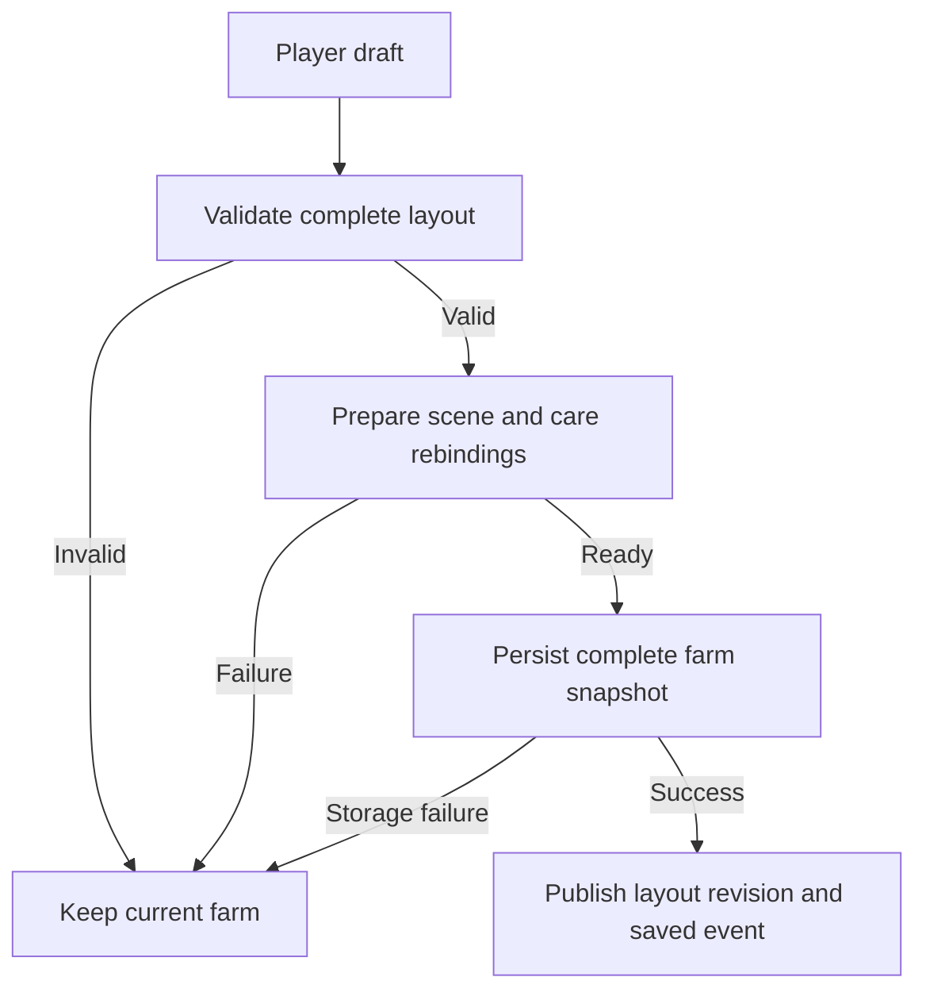

# Sunny Acres: player-editable animal pens

Status: written design for owner review. The owner approved the conversational Edit-mode approach with **yes**. This document has not yet been approved; no pen-editor product code, save migration, dependency, test assertion or deployment has changed.

Repository baseline: `1115f93101a0e86fdcc9780e053c17b73dd6dac5`, tree `77d5e453112f56fd87b6eabfb62c6c28af10e88d` (PR95). The completed publication receipt is `evidence/remaining-care-pr95-publication-20261021` at `2f0e9ccdb7c2efe3c1864a5d74ef967d18cbcc8a`. That receipt records 37 premerge checks, 17 postmerge checks and 3 Pages jobs successful, with 27 live runtime files and the normal entry matching the release. These results qualify the existing release, not this future feature.

## Owner outcome and release scope

Players can expand every animal enclosure, add or adjust real fences and gates, and move animal buildings to other valid areas of their existing farm. The existing farm remains the starting layout. Animal care must keep working after editing, saving, offline reopening and account recovery.

Extend **Edit → Animal pens** with a draft preview and **Apply / Cancel**. Cows, chickens, horses and sheep retain separate enclosures. Dog and cat keep free roaming, with relocatable care nooks. Existing animal limits remain 5 cows, 30 chickens, 4 horses, 5 sheep, one dog and one cat. No animal purchase, feed cost, timer, reward or progression rule changes.

Design decisions proposed for this release:

- Fence reshaping and moving existing animal structures are free layout actions. No new fence currency, purchase or refund system is introduced. Fence amount is bounded by the geometry limits below.
- Players can reshape or enlarge pens while preserving at least the accepted baseline enclosure area and every required care route. Expansion adds walking room, not additional animal capacity.
- Animal buildings translate on the map; their accepted dimensions, facing, bed spacing, appearance choices and anatomy remain unchanged. Building rotation, scaling and demolition are outside this release.
- The existing building/tree/decor editor remains available. Its current immediate-save behavior is unchanged. The new Animal pens submode owns the draft transaction and cannot mix unfinished pen edits with that older editor.
- Crop plots, the storage barn, roads, terrain, land purchases, production-building features and other projects are outside this release. Existing production buildings remain movable through their current editor.

## Why this approach

| Approach | Result | Decision |
| --- | --- | --- |
| Extend Edit with fence handles and movable animal structures | Reuses the established camera and touch model, supports the requested layout freedom, and centralizes validation | Selected; owner approved the approach |
| Preset pen-size buttons | Smaller implementation, but cannot satisfy individual fence adjustments or independent building placement | Insufficient for the requested feature |
| Full map/construction editor | Could alter terrain, roads, fields and ownership, with a much larger save and gameplay surface | Outside this milestone |

## Grounded constraints in the current build

The current editor is in `index.html`: `setEdit`, `editHit`, `editValid`, `commitEdit` and `applyLayout`. It saves production building and tree positions in `layout.b/t`; decorative placements are saved separately. Animal yards and their care docks use fixed world coordinates.

Current `PENS`, `inPen`, `intoPen`, `outOfPens`, remaining-care containment and forbidden-polygon segment checks assume convex outlines. Supporting a concave player fence requires correct general simple-polygon containment, nearest legal points and continuous segment clearance. Reusing the current convex half-plane test for a concave pen would trap or exclude animals incorrectly. This is a required, targeted geometry change; accepted gait, speed, neighbour clearance and existing physical test tolerances remain unchanged.

Some current models merge geometry across logical parts: cow static meshes combine shelter, beds, fence, pipe and robot, and remaining-care meshes combine parts by material. Moving only their empty logical groups would leave visible meshes behind. Custom-layout factories must build from resolved component geometry, with interaction bounds and animated attachments registered from the same source. Retain the default construction path so an unedited farm preserves its accepted geometry and placement.

Read-only measurements from the current exported layouts:

| Pen | Minimum enclosure area | Minimum exterior gate width |
| --- | ---: | ---: |
| Chicken | 125.28 m² | 1.50 m |
| Cow | 176.12 m² | 2.30 m |
| Horse | 161.755 m² | 4.25 m |
| Sheep | 195.70 m² | 4.00 m |

The horse outline contains `[-23.5,-31.8]` and `[-23.5,-19.8]`, outside `onFarm(x,z,24)`. Its accepted default must not be moved or rejected to satisfy the ordinary decor mask. Pen-editable land is the union of the existing farm placement mask and the approved animal-site footprints/approaches from this baseline. Existing plot-deed counts do not define that land mask. This feature does not expand the world or move the accepted stone path.

## Player interaction

1. Open Edit, choose Animal pens, then select an owned species or pet nook. The camera keeps the existing north-up map and pan/zoom controls. Unowned pens cannot be placed for free.
2. Tap a fence edge to select it. Drag an edge or corner; **Add post** splits a selected edge and supplies another reshape handle. **Remove post** reconnects its neighbours, subject to complete validation. **Add fence** draws an interior run using two endpoint taps. Selecting a run exposes move/remove controls. No edit may leave an accidental gap in the outer enclosure.
3. **Add gate** places a real gap on a selected outer edge or interior run. Gate handles move or widen it. Gates stay at least the species minimum width; at least one exterior gate remains. Each gate has clear approaches on both sides. Gate animation/open-close gameplay is not added.
4. Drag an animal building or care unit to another valid location. **Move pen** translates the complete selected enclosure and its structures together; individual building moves remain available. This bulk move also lets a player place a care yard whose original location is obstructed on an older save.
5. Draft fences and structures show green/red placement feedback and a short reason, such as “Leaves a bed unreachable” or “Blocks the stone path.” An invalid draft can be corrected without losing earlier draft gestures. Apply stays disabled until the newest draft passes validation; a previous green result cannot authorize a newer invalid gesture.
6. Apply saves all edited animal sites together. Cancel discards every pen draft and restores the prior camera/selection state. Closing a dirty pen editor offers Apply/Discard/Keep editing; navigation or reload never silently applies the draft.

Use at least 44×44 CSS-pixel touch targets and a selected-item action strip rather than requiring precise taps on thin fences. Provide one-metre nudge buttons and keyboard equivalents. Dragging snaps only the geometry the player edits; opening the editor never rounds existing decimal coordinates. A second touch cancels the current drag and enters camera control, retaining earlier completed draft gestures. Splitting or removing an edge must preserve its gate's stable identity and valid span, or mark the draft invalid until the player repositions it; a gate cannot silently disappear.

Animal physical updates pause during the pen draft so actors do not collide with preview geometry. Production, supply expiry and elapsed wall-clock recovery keep their current rules. No global clock override or auth/account hold flag is repurposed. Game care/purchase taps cannot act through the editor. On exit, discard accumulated physical frame time so animals do not rush forward to catch up.

## Movable structures and their attached functions

| Selectable unit | Parts that move together | Requirements |
| --- | --- | --- |
| Chicken coop | Accepted coop, roof details, 30 beds, both doorways, both ramps and all support samples | Both doors retain usable independent entry/exit routes and clear waiting areas |
| Chicken feeder, waterer, egg stand | Each unit, its visible contents, hit target, contact docks and collision | Feeder/waterer docks stay inside the pen; egg stand may stay outside if its player approach is clear |
| Cow shelter | Shelter, five beds, dividers and supporting slab | Bed IDs and spacing remain stable; cow-width aisles remain connected |
| Cow feed bunk and trough | Each unit with its supplies, contact positions, hit target and collision | Supplies and paid cycles do not change when moved |
| Cow robot assembly | Robot, tank, connecting pipe, roof/support, animated arms/gates and all entry/dock/exit/turn/clear points | Saved job identity, stage, batch, queue, tank and reward receipts remain authoritative |
| Horse or sheep shelter | Species shelter, 4 or 5 beds, existing attached food/water units, support and docks | Fixed slot IDs/capacity; fixtures remain reachable for the full owned herd |
| Dog or cat nook | That pet’s food, water, bed, contacts and approach positions | Free-roaming routes remain legal outside enclosures |

Internal furnishings are attached to their unit; individual bed rearrangement is not added. Splitting cow render batches into these units is an authorized layout adaptation, not a model redesign. Support slabs follow their units; they cannot remain as invisible obstacles at old coordinates. Cosmetic choices and supply displays follow the same unit IDs.

## Saved model and compatibility

Add a bounded optional `layout.animalPens` object. Its schema has `v:1`, a monotonically increasing layout `revision`, and a `sites` map keyed by `chicken/cow/horse/sheep/dog/cat`. A customized site records a recognized frozen template ID, an ordered outer boundary with stable vertex IDs, real gates anchored to stable edges, optional interior fence runs, and named structure positions. All saved positions are finite world-space metres. Whole-pen movement translates those records; derived station paths, reservations, renderer objects and animal positions are not saved.

Only customized sites are stored. An absent site uses the exact accepted default factory and existing installation/fallback policy. A pet site has no enclosure boundary or fence tools. Template IDs preserve component dimensions and station identities across later releases. Unknown template/schema versions must be retained and opened read-only with an update/recovery message, never silently replaced by defaults and saved over.

Limits per penned species: 3–24 boundary vertices, 0–24 interior runs, 1–4 total gates including at least one exterior gate, and only the fixed owned structure IDs above. Gate endpoints must fit their edge with post clearance; new fence runs are at least one metre long. Existing shorter default fence stubs remain valid. The entire custom-layout payload is at most 32 KiB. Nonfinite values, duplicate IDs, unknown owners/structures and out-of-range fields are rejected without changing the saved bytes.

Use save writer version 4, with a new version-3 migration and a frozen actual version-3 predecessor fixture. Keep the older migration functions and fixtures unchanged. A farm is promoted to writer4 only after its first successful custom-layout Apply; opening/cancelling the editor must not promote it. Farms without customized pens retain current writer1/2/3 behavior. A stale writer3 must refuse to overwrite a writer4 farm, including through saved-event/cloud backup paths. Settings export/import and newer-save protection must preserve the complete custom layout.

Keep the existing owner-only cloud JSON envelope, revision conflict flow, SDK and Firebase rules. No additional collection, callable, permission or background sync system is needed. Validate round-trip behavior through the actual emulator flows rather than assuming an extra JSON field is sufficient.

## One resolved layout for rendering and movement

Use a pure saved-layout resolver and validator, an editor draft controller, and a scene/coordinator adapter. Proposed modules are `animal-pen-layout.js`, `animal-pen-editor.js` and `animal-pen-runtime.js`; these names describe future implementation boundaries, not existing code.

- The resolver combines known templates and saved positions into an immutable revision containing polygons, fences/gates, component transforms, station docks/contacts, support surfaces, approach guards, interaction bounds, safe waiting positions and pathing obstacles. Rendered fences and collision boundaries cannot use different copies of the layout.
- The validator checks that revision against current farm objects, the accepted path/land masks, support samples and all owned animals. It returns structured reasons and never spends or saves.
- The draft controller owns selection, gesture history within the draft, preview meshes, dirty state and Apply/Cancel. It has no economy authority.
- The runtime adapter prepares replacement yard resources and care rebindings off-scene, then publishes one layout revision to `PENS/PEN_LIST`, `BLOCKS/OBST/fenceSegs`, hit targets, care controllers, lighting anchors, ground support and vegetation-clearing ownership together. Old geometry/resources remain available until commit succeeds.

Yard factories take optional resolved layouts, preserving their current defaults and public result contracts. Station IDs remain stable. The existing station scheduler already has snapshot/restore support; controller rebinds must preserve valid reservation generations, lane/FIFO order, pose state and night/wake barriers. Cached paths from the old revision are discarded. A matching old station reference cannot retain old coordinates.

## Validation and Apply transaction

An accepted draft must meet all of these conditions:

- Outer boundaries are simple closed polygons with no crossings, holes or degenerate edges; concave shapes are supported. Their area stays at least the species baseline above. Interior runs may not isolate required care or staging areas.
- Every fence segment, whole building footprint, supported ramp and approach stays on pen-editable land and clear of unrelated buildings, crops, decor, neighbouring pens, fixed scenery collision and the accepted stone path. Check full shapes and continuous segments, not only centres or corners. Shared-fence ownership and overlapping enclosures are not introduced.
- There is a body-clearance route from each legal animal staging position to every relevant assigned bed/feed/drink dock, to each required doorway and to an exterior gate. Both sides of every gate remain usable. Internal fences cannot cut through protected care corridors or waiting areas. Actual standing/turning skin and existing contact assertions remain part of validation/qualification; a centre-point route alone is insufficient.
- Every owned animal has a distinct legal position after Apply, with its existing species clearance, and all waiting positions stay out of active approaches. The building support sampler must prove supported beds, mouth targets and traversable height transitions. Placements requiring terrain alteration, unsupported foundations or unwalkable steps are rejected.
- The full enclosure can be edited, not just a newly visible yard. On an obstructed legacy/fallback farm, prepare and validate the owned care site at the chosen location; keep the old area/objects until Apply succeeds. Never move or delete a paid object automatically to install it.

Ordinary animal roaming remains contained. A real gate is an explicit passage between its inside and outside approaches; it cannot look open while collision or routing treats that span as a solid boundary. Qualify player passage and directed animal entry/exit separately, then together, for every species' edited exterior gate. The coop's two building doorways remain separate from its yard gate and retain their existing lane rules.

Draft previews use lightweight fences/bounds. Perform geometry validation on the latest revision, at most every 150 ms during drag, and run final complete validation at Apply. Reject stale async results. Bound searches to the current finite farm footprint and profile the maximum allowed fence counts; preview work cannot create an unbounded per-frame path search.

The transaction checks farm identity, base layout revision and latest world obstacles immediately before commit. Account switching, restoring a backup, visiting or a stale/future-version farm cancels or disables the draft. Ordinary production ticks do not invalidate it just because time has advanced; they are settled through the existing game path before creating the candidate full-farm snapshot.

Prepare all resources and deterministic animal rebindings before writing. Refactor only the necessary shared save preparation/notification path so the candidate complete farm can be written once to the existing local save key without replacing the live farm object identity. On storage failure, retain the old saved bytes, layout, scene and absence of a saved event. Paid state follows the same elapsed-time settlement as an otherwise identical normal save, not an artificial frozen clock.

After a successful atomic local write, publish the prepared layout and update the live layout/version in one synchronous turn, then emit the existing saved event once. Cloud backup keeps its normal conflict semantics. Old resources are disposed only after the new revision is active. If an unexpected error occurs after persistence, the complete new save remains authoritative and the app stops old-layout writes and performs a controlled reload/recovery; it must not roll back cloud state or overwrite a valid new save with a partial old draft. A crash between persistence and scene publication must reload the complete new layout.

Preserve each animal’s current world position when it remains legal. An animal supported by a moved occupied structure moves once with that structure in its local support frame, retaining its slot/task; this is an explicit edit relocation, not a normal walking-speed bypass. An animal excluded by a resized boundary is assigned one of the prevalidated clear staging positions. Ordinary movement never uses relocation to solve a queue. After Apply, movement resumes through existing stand/entry/exit/yield logic and the newly resolved routes.

Cow robot rebinding is stage-aware: approaching jobs still require actual docking; docked/milking cows follow the moved assembly without a new dock report; exiting jobs keep their identity and must physically follow the new exit/turn/clear route. Editing cannot finish/cancel a job, change `startedAt`, credit milk/XP, restock supplies or reset a paid cycle. If the clock changes a job’s stage during the draft, rebind the current authoritative stage, not its earlier preview stage.

## Qualification checkpoints

These are acceptance gates for the later implementation plan. No new test has been run or passed for this design document.

| Phase | Acceptance criteria |
| --- | --- |
| A — Saved model/geometry | Defaults resolve to accepted baseline; meaningful old-writer/invalid-save red–green cases; concave containment and continuous fence/rectangle/circle clearance; limits and legacy horse placement coverage |
| B — Runtime layout adapters | Identity layout preserves existing appearance/support; translated units carry visible geometry, interactions, collision, animated parts, scenery ownership and care targets together; no old invisible walls or duplicate resources |
| C — Editor transaction | Trusted native touch/mouse editing at 390×844, 844×390, 768×1024 and 1280×720; expand/reshape/add interior fence/move gate/move building/move pen; invalid Apply, storage failure and Cancel leave saved layout unchanged; interrupted/stale gestures cannot commit |
| D — Full animal care | Maximum ownership of all 46 animals; three sleep/wake cycles with full 40-second normal waking periods after each edit; explicit second bedtime, unique sleep slots, clear waiting and no doorway deadlocks; separate and combined entry/exit for both coop doors; all paid feeds/contact and cow robot phases remain correct |
| E — Recovery/compatibility | Actual installed cache63 → candidate update, writer3 → writer4 protection, night reload, offline reopen, background/return, account switch, visiting, backup export/import and same-account conflict recovery; exact paid-state equality against equal-clock controls |
| F — Regression/resources | All required exact-head Node/browser/cloud, cow/chicken/remaining-care and editor gates; accepted character/rig, land/path, market, planting, decor, lighting, auth and other farm behavior preserved; 20 repeated edit/apply/cancel/rebuild cycles with stable owned GPU resources and bounded preview work |
| G — Owner release | Actual edited-game phone/tablet/desktop renders shown and inspected; owner visual/merge approval; merge pinned qualified head; verify Pages, live bytes and actual postmerge checks; emulation clearly distinguished from physical devices |

Keep the current care deadlines, physical tolerances, native-input trust/timing checks and frozen failure evidence. Existing default tests keep asserting default layouts; add edited-layout coverage rather than rewriting defaults to match the implementation. Add failure injection around the transaction and a captured exact-state fixture for each proven new defect. Do not retry an unchanged failed hypothesis or bypass a failing check.

The candidate will need a new game import and service-worker/cache version because `game.js` and new modules will change. Against this baseline those next versions would be game31/cache64; recheck fresh main before assigning them and retain every existing cache/installed-update assertion except the legitimate version expectation. No dependency or SDK upgrade is part of the feature.

## Protected boundaries and review result

The owner’s request necessarily includes narrowly scoped animal-layout save fields, editor UI, pen containment/collision and care-coordinate adapters. Those are the proposed protected-system exceptions for review. Accepted animal geometry/gait modules, item/animal IDs, purchase limits, supplies/economy/reward/robot ledger semantics, cloud/auth security, unrelated renderer APIs, default farm placement, other projects and all historical evidence remain protected.

Self-review: the design covers all requested pens and building moves; records the free-editing/capacity/rotation decisions explicitly; handles convex-only routing, merged meshes, the legacy horse boundary and obstructed saved farms; separates geometry from paid state; specifies rollback/recovery and resource ownership; and provides per-phase acceptance. It is a design review by the sole implementer, not an independent audit or a measured performance result.

Next gate: owner review of this written specification. After approval, prepare the written implementation plan on a fresh verified main baseline. No implementation, new-feature merge or visual approval is inferred from approval of the earlier conversational approach.
