# Homestead renderer preview — desktop checkpoint

Actual isolated renderer code 3b4533e6a42a13cd218c1d4bbf2e133ee8c214f8; production source d5ed6a96c50914320f30a7b74b799b7f66a9b6e0. **Preview only, not accepted final art or implemented layout/save mechanics.**

The red barn, cream decorative farmhouse, six workshop variants, four species enclosures, connected paths and separated synthetic crop fields are rendered in the current game composer. Accepted animal modules are unchanged. Farmhouse has no production/interior/purchase role; the proposed Layout strip is nonfunctional. The wider zoom ceiling and60 m animal roam bound are local fixture patches; production is unchanged.

The runner stopped at the mobile Walk fixed-DPR assertion. The12 desktop images remain available; four mobile baseline images are diagnostic/incomplete. Preliminary desktop timings are short PC samples, not sustained phone acceptance.

## full-farm-noon

Requested camera/profile/preset pair. Actual camera position maximum delta: 0.000000 m; quaternion delta 0.000000. Camera positions match.

Before:

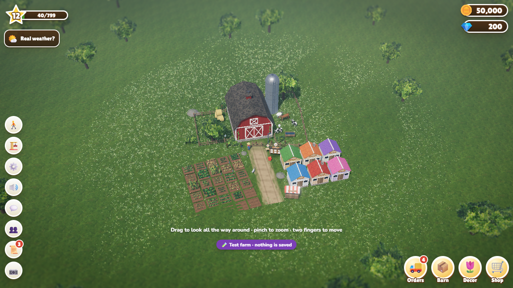

Preview:

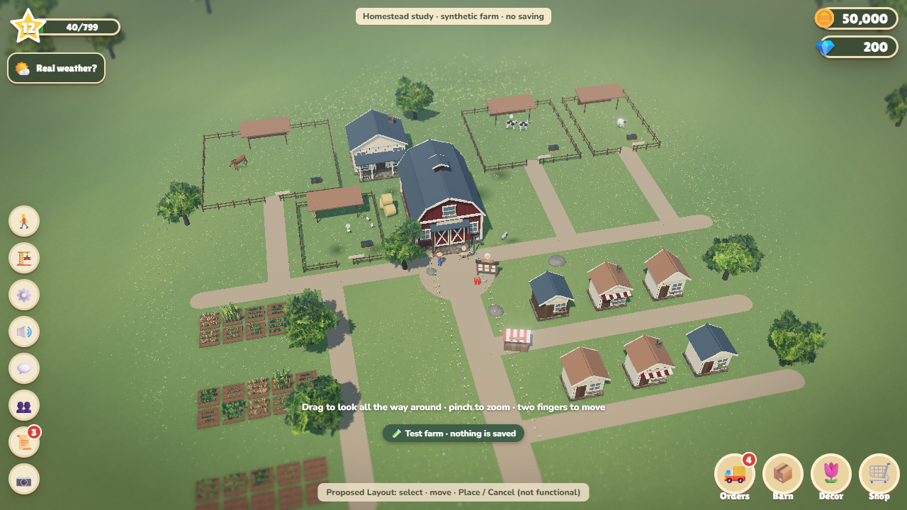

## courtyard-noon

Requested camera/profile/preset pair. Actual camera position maximum delta: 0.000000 m; quaternion delta 0.000000. Camera positions match.

Before:

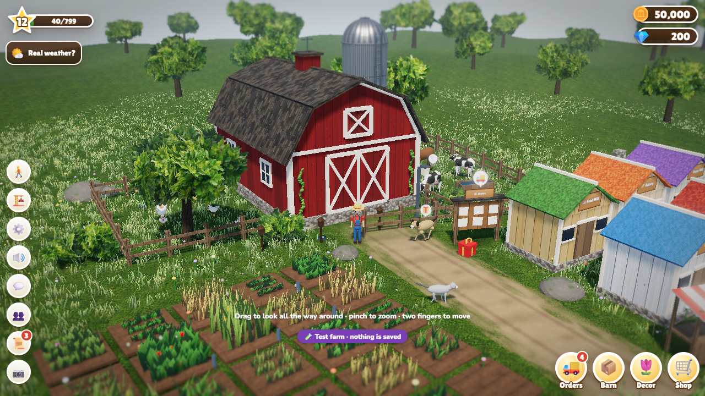

Preview:

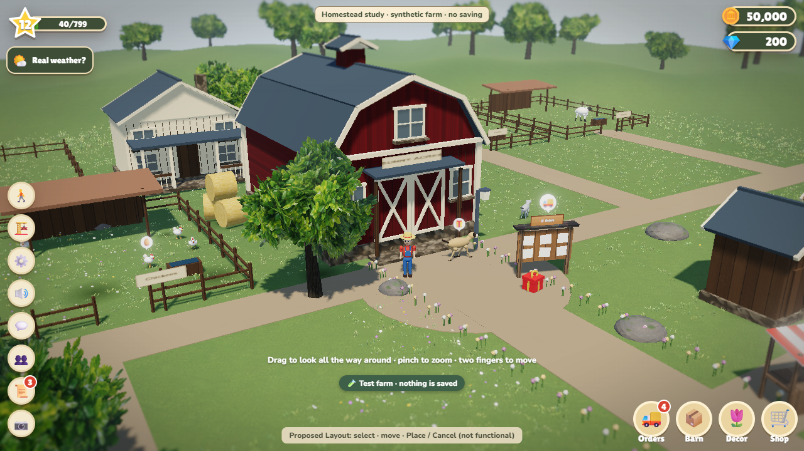

## courtyard-golden

Requested camera/profile/preset pair. Actual camera position maximum delta: 0.000000 m; quaternion delta 0.000000. Camera positions match.

Before:

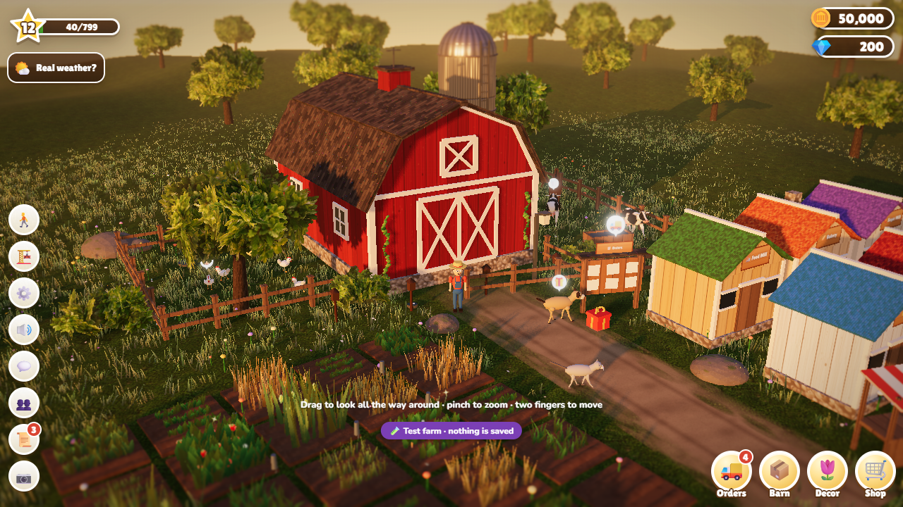

Preview:

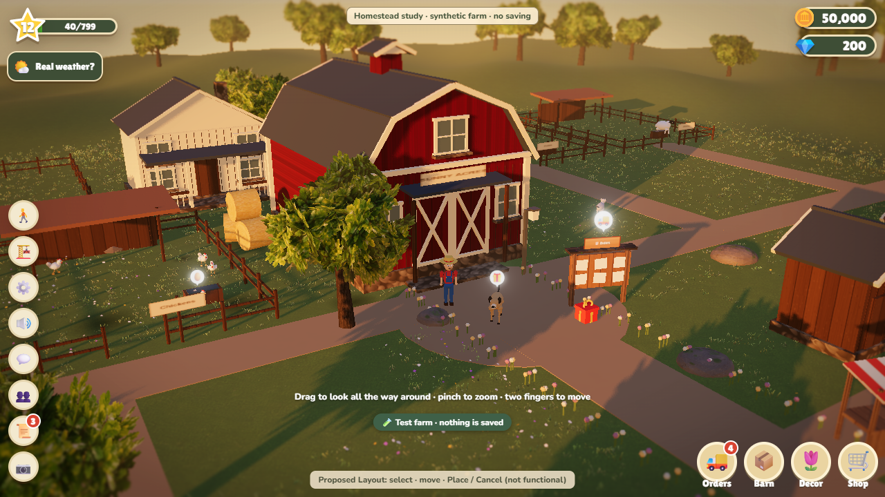

## walk-field-noon

Requested camera/profile/preset pair. Actual camera position maximum delta: 0.000000 m; quaternion delta 0.000000. Camera positions match.

Before:

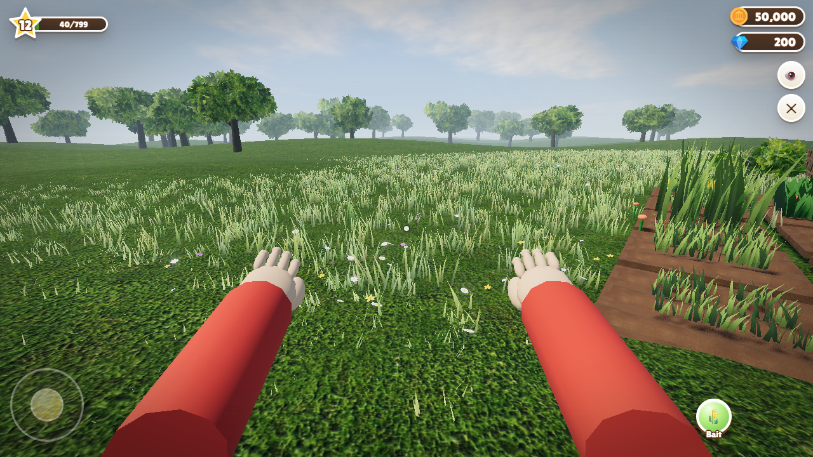

Preview:

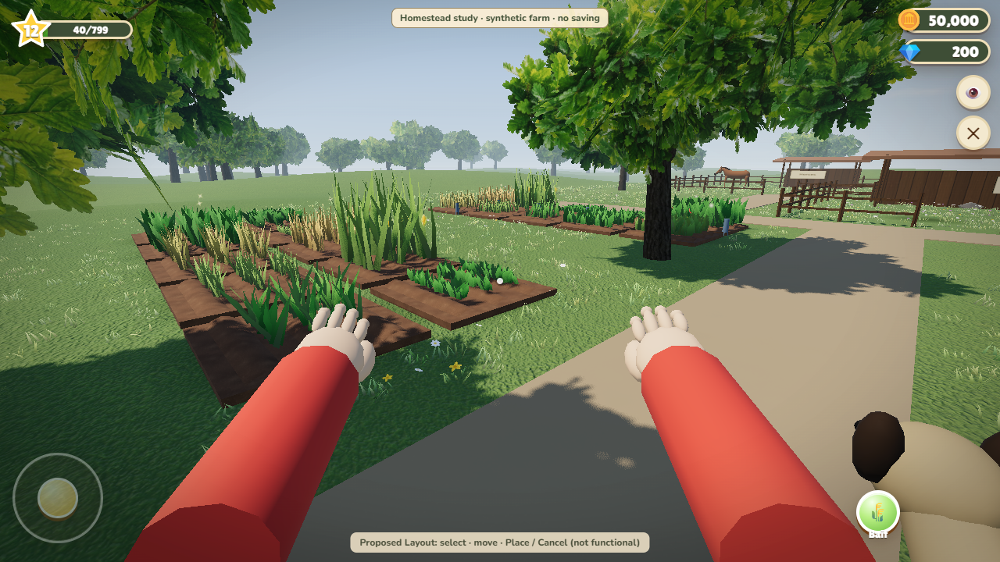

## walk-horse-gate

Requested camera/profile/preset pair. Actual camera position maximum delta: 0.000000 m; quaternion delta 0.000000. Camera positions match.

Before:

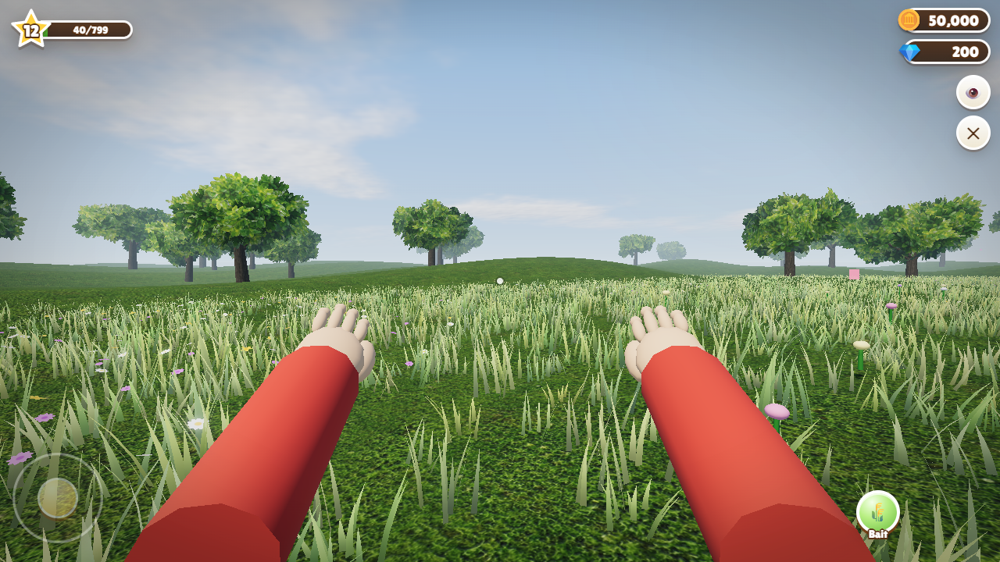

Preview:

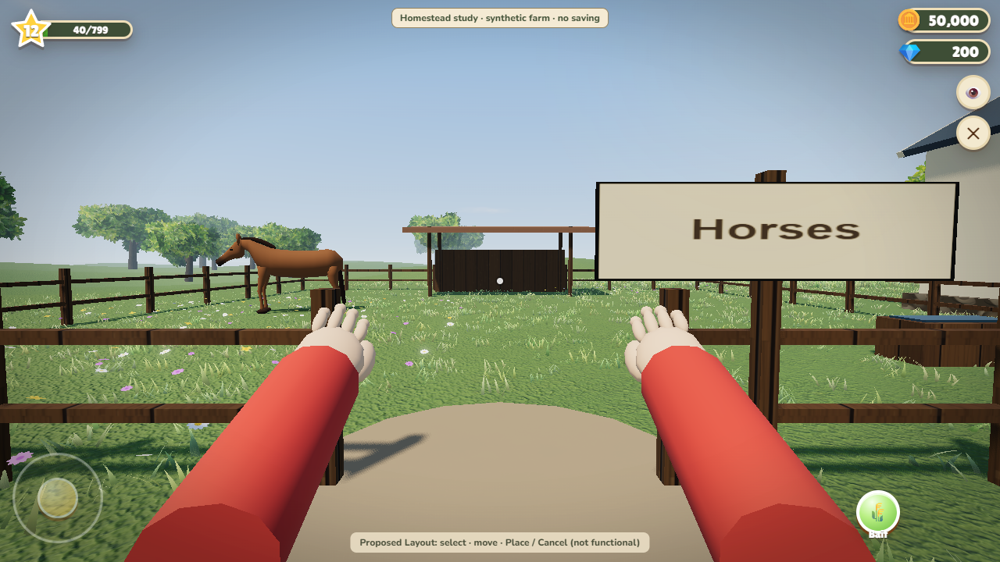

## walk-farmhouse

Requested camera/profile/preset pair. Actual camera position maximum delta: 0.050000 m; quaternion delta 0.000000. Collision offset means this is an illustrative pair pending recapture at a common safe pose.

Before:

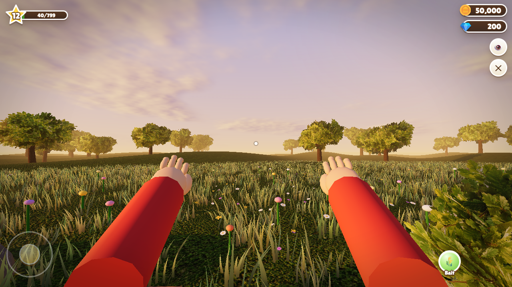

Preview:

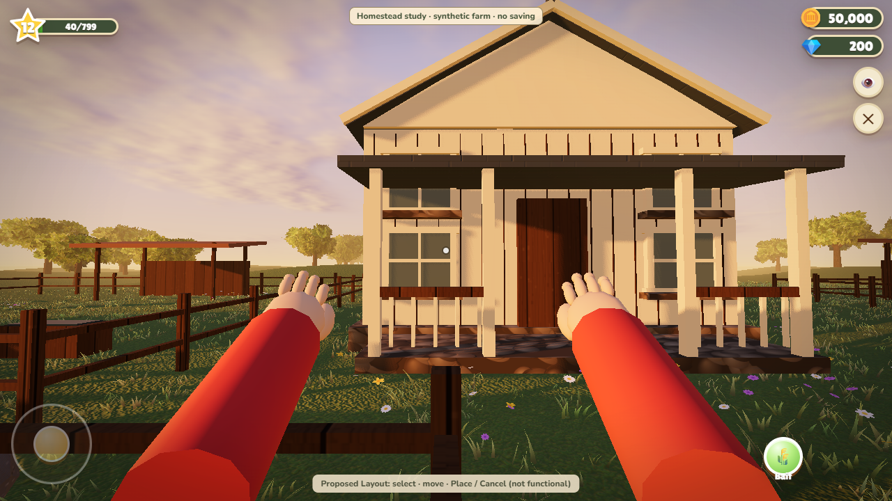

## Remaining work

Correct fresh synthetic quality preference; do not loosen the DPR assertion. Complete mobile before/after, weather/reduced-motion and resource/isolation checks. Review camera offsets above, overview framing and coarse surfaces. Field-Walk draw-call p95 exceeds the proposed incremental budget despite modest CPU/GPU timing; no complete budget pass is claimed. Keep all original diagnostics. No runtime integration, save migration, pricing changes, deploy, merge, release or phone test.
