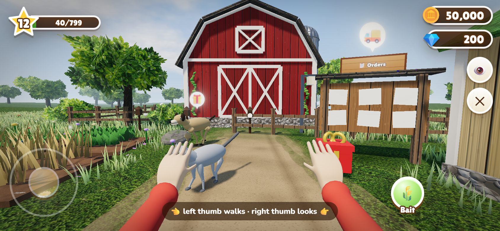
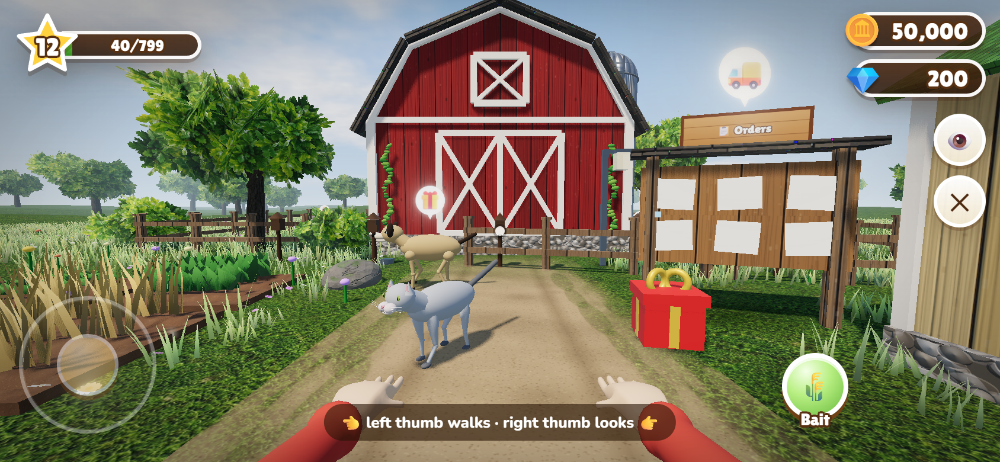
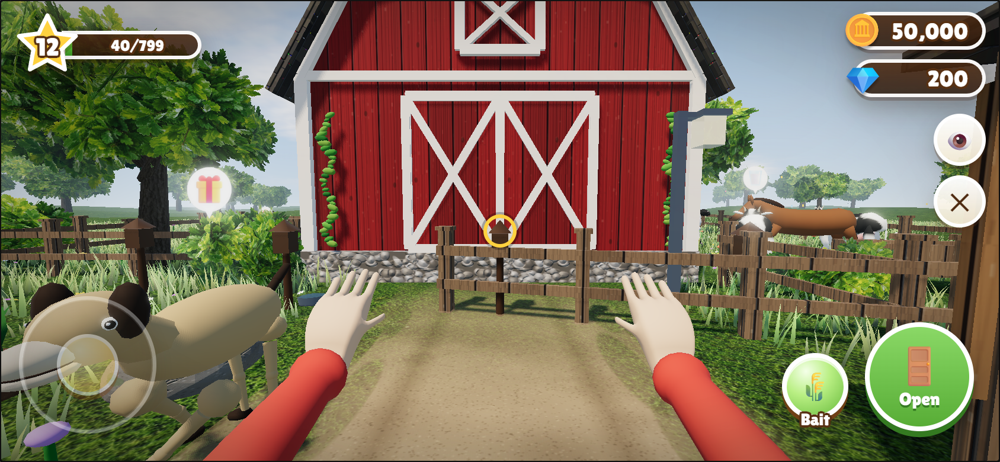
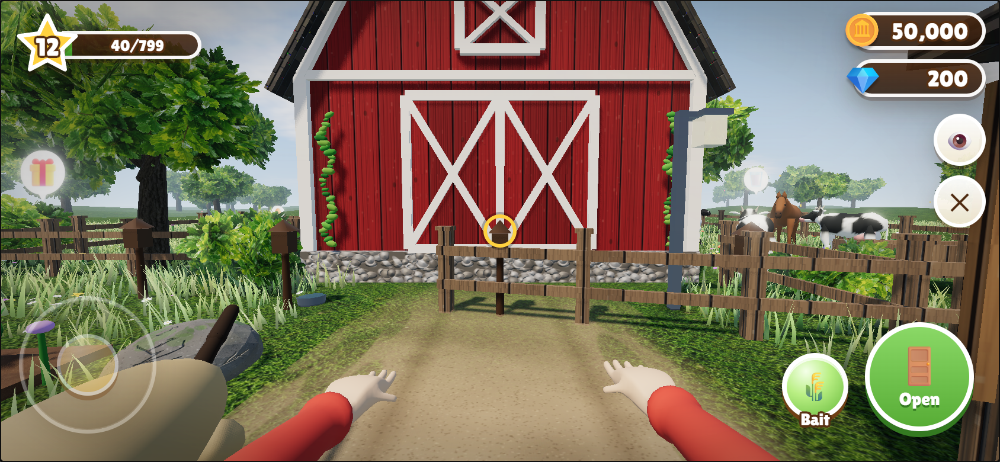
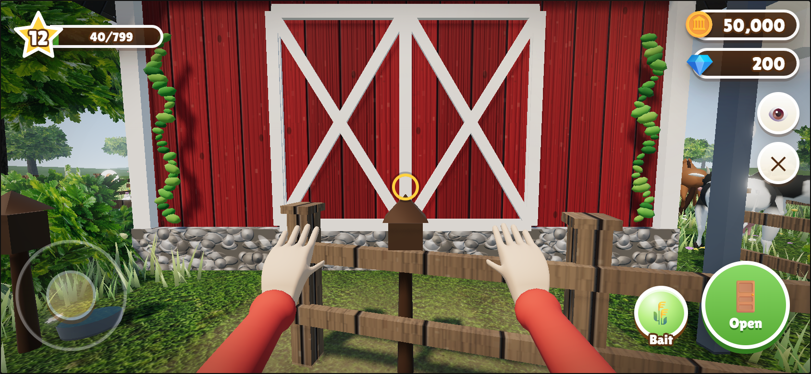
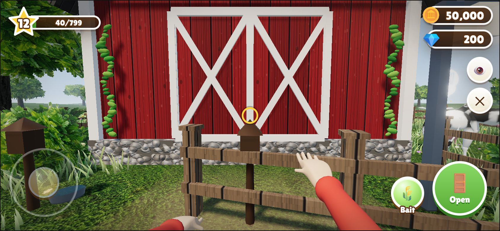

# Player rest and movement

[Combined eight-second comparison](player-before-after.webm) · [Test report and pending gates](REPORT.md)

Before above, after below in the combined clip. The character asset and controls are unchanged; this is an isolated synthetic preview. Appearance and performance acceptance remain open.

| Movement | Before | After |
|---|---|---|
| Walk / stop | [Original clip](before-walk.webm) | [Corrected clip](after-walk.webm) |
| Run / stop | [Original clip](before-run.webm) | [Corrected clip](after-run.webm) |

## Rest

## Walk

## Run

Mobile-sized PC evidence. No new physical-phone round.
